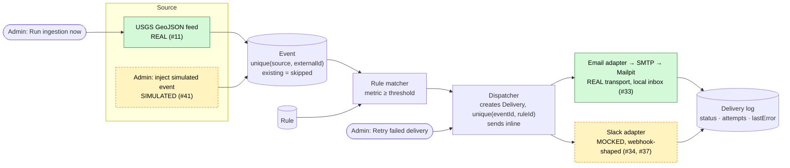

# Design: the slice being built

This describes what will be built after the **Scope cut** in [DECISIONS.md](DECISIONS.md). Numbers like `#24` refer to entries in that file. Items that were cut are listed at the end.

## 1. Pipeline



Green means real and dashed yellow means simulated or mocked. There is no worker or queue: the button runs the whole pipeline synchronously.

## 2. Data model

| Model        | Field                 | Type                                    | Notes                                                                       |
| ------------ | --------------------- | --------------------------------------- | --------------------------------------------------------------------------- |
| **User**     | id                    | String (cuid)                           | PK                                                                          |
|              | name                  | String                                  |                                                                             |
|              | email                 | String                                  | unique                                                                      |
|              | role                  | String: `user` \| `admin`               | #16 (❓ whether Prisma supports enums on SQLite: to verify)                 |
| **Category** | id                    | String                                  | PK. Seeded, no CRUD (scope cut)                                             |
|              | key                   | String                                  | unique, e.g. `earthquake`                                                   |
|              | name                  | String                                  |                                                                             |
|              | metricType            | String                                  | key into the metric registry (§4), e.g. `magnitude`                         |
| **Rule**     | id                    | String                                  | PK                                                                          |
|              | userId                | → User                                  | many rules per user (#19)                                                   |
|              | categoryId            | → Category                              |                                                                             |
|              | threshold             | Float                                   | rule matches when metric ≥ threshold (#53)                                  |
|              | channelType           | String                                  | key into the channel registry (§3)                                          |
|              | channelConfig         | Json (or String)                        | validated by the adapter (#36). ❓ Prisma Json support on SQLite: to verify |
|              | createdAt             | DateTime                                |                                                                             |
| **Event**    | id                    | String                                  | PK                                                                          |
|              | source                | String: `usgs` \| `simulated`           |                                                                             |
|              | externalId            | String                                  | **unique(source, externalId)** (#26)                                        |
|              | categoryId            | → Category                              |                                                                             |
|              | title                 | String                                  |                                                                             |
|              | occurredAt            | DateTime                                | UTC (#51)                                                                   |
|              | sourceUrl             | String?                                 | null for simulated events                                                   |
|              | metrics               | Json (or String)                        | e.g. `{ "magnitude": 5.4 }` (#22)                                           |
|              | createdAt             | DateTime                                |                                                                             |
| **Delivery** | id                    | String                                  | PK                                                                          |
|              | eventId               | → Event                                 | **unique(eventId, ruleId)** (#24, #28)                                      |
|              | ruleId                | → Rule                                  |                                                                             |
|              | status                | String: `pending` \| `sent` \| `failed` |                                                                             |
|              | attempts              | Int                                     | +1 on every send attempt                                                    |
|              | lastError             | String?                                 |                                                                             |
|              | sentAt                | DateTime?                               |                                                                             |
|              | createdAt / updatedAt | DateTime                                |                                                                             |

Relations: User 1–n Rule · Category 1–n Rule · Category 1–n Event · Event 1–n Delivery · Rule 1–n Delivery.

## 3. Channel adapters (#35, #36)

```ts
type ChannelType: string;

interface AlertMessage {
  subject: string;
  text: string;             // plain text, same for every channel (#32); includes source link (#50)
}

type ConfigResult<T> = { ok: true; config: T } | { ok: false; errors: string[] };
type SendResult = { ok: true } | { ok: false; error: string };

interface ChannelAdapter<TConfig> {
  readonly type: ChannelType;
  readonly label: string;
  validateConfig(raw: unknown): ConfigResult<TConfig>;   // used on rule create AND before each send
  send(message: AlertMessage, config: TConfig): Promise<SendResult>;
  describeConfig(config: TConfig): string;               // for admin tables; masks secrets (#43)
}

interface EmailConfig { to: string }
interface SlackConfig { webhookUrl: string }             // mock only; shaped for the real swap (#37)

interface ChannelRegistry {
  get(type: string): ChannelAdapter<unknown> | undefined;
  list(): ChannelAdapter<unknown>[];                      // drives the channel picker in the rule form
}
```

`Rule.channelConfig` is stored as untyped JSON. Each adapter turns it into its typed config through `validateConfig`, so the schema doesn't change when a channel is added.

## 4. Metric types (#9, #52, #53)

```ts
interface MetricType {
  readonly key: string; // matches Category.metricType, e.g. "magnitude"
  readonly label: string; // "Magnitude"
  readonly unit?: string;
  extract(metrics: unknown): number | null; // reads the value from Event.metrics; null if absent or invalid
  validateThreshold(raw: unknown): ConfigResult<number>; // e.g. numeric, within a sensible range
}

interface MetricRegistry {
  get(key: string): MetricType | undefined;
}

declare function meetsThreshold(
  value: number | null,
  threshold: number
): boolean;
```

**Evaluation.** To check an event against its category's rules:

1. Look up `Category.metricType` in the metric registry. Only `magnitude` exists in the build (scope cut).
2. Call `extract(event.metrics)` to get the value.
3. A rule matches when the value is not null and the value ≥ `rule.threshold`. A null value never matches.

## 5. Ingestion flow

1. An admin clicks **Run ingestion now** (#12). The server calls the ingestion function for the `usgs` source.
2. **Fetch the feed.** If the fetch or parse fails, the error is logged to the console and returned to the admin, and nothing is written.
3. **Normalise.** Each feature becomes `{ source, externalId, title, occurredAt, sourceUrl, metrics }`, in the Earthquake category. Features missing required fields are skipped and logged.
4. **Deduplicate.** If an event with the same (source, externalId) already exists, it is skipped and not updated (scope cut #29). Otherwise a new Event is inserted. If two runs insert the same event at once, the unique constraint turns the second insert into a skip.
5. **Match.** For each new Event, load the rules for its category and evaluate each one as in §4.
6. **Create deliveries.** For each matching rule, insert a Delivery with `status = pending` and `attempts = 0`. A unique violation on (eventId, ruleId) means it already exists, so it is skipped.
7. **Dispatch inline** (scope cut #23):
   1. Find the adapter with `registry.get(rule.channelType)`.
   2. Validate the rule's config with `adapter.validateConfig(rule.channelConfig)`.
   3. Build a plain-text message that includes the source link (#32, #50). Simulated events are labelled `[SIMULATED]` (#41).
   4. Call `adapter.send()`.
8. **Record the result.**
   - **Success:** `status = sent`, set `sentAt`, add 1 to `attempts`.
   - **Failure:** this covers an unknown channel type, an invalid config, a send that returns `ok: false`, or a thrown exception. The delivery gets `status = failed`, the error is stored in `lastError`, and `attempts` goes up by 1.
   - A failed delivery never stops the run. Processing continues with the next delivery.
9. **Return a summary** to the admin and the console: number fetched, new, skipped, sent and failed.

Two other actions use the same flow:

- **Retry** (#27, manual only): available only for a failed Delivery. It runs steps 7–8 again on the same row. No new row is created, because of the unique (eventId, ruleId) constraint.
- **Inject simulated event** (#41): inserts an Event with `source = simulated` and a generated `externalId`, then continues from step 5.

**USGS GeoJSON fields this design relies on** (all to verify against the live feed; the feed URL and time window are to verify too):

| Field                                     | Used for                                   | Status    |
| ----------------------------------------- | ------------------------------------------ | --------- |
| `features[]`                              | the list of events                         | to verify |
| `features[].id`                           | `externalId`                               | to verify |
| `features[].properties.mag`               | `metrics.magnitude`. Can it be null?       | to verify |
| `features[].properties.time`              | `occurredAt`. Format/unit (e.g. epoch ms?) | to verify |
| `features[].properties.title` or `.place` | `title`                                    | to verify |
| `features[].properties.url`               | `sourceUrl`                                | to verify |

## 6. Folder structure

```
prisma/
  schema.prisma
  seed.ts                    # users (one admin), Earthquake category, sample rules
src/
  app/
    page.tsx                 # user: switcher, my rules, create/delete (#14, #49)
    admin/page.tsx           # read-only tables + actions
    admin/actions.ts         # runIngestion, injectSimulatedEvent, retryDelivery
  lib/
    db.ts
    current-user.ts          # seeded-user switcher (no auth)
    ingestion/run.ts         # steps 1–9
    ingestion/sources/usgs.ts
    ingestion/sources/simulated.ts
    metrics/types.ts  metrics/registry.ts  metrics/magnitude.ts
    matching/matcher.ts
    channels/types.ts  channels/registry.ts  channels/email.ts  channels/slack-mock.ts
    dispatch/dispatcher.ts   # steps 7–8, also used by retry
    dispatch/message.ts
docs/
```

## Designed but not built (scope cut)

- **#21/#23 queue and worker:** a separate worker would poll every ~5 minutes and send pending deliveries from a queue table.
- **#27 automatic retry:** retries with backoff, using a `nextAttemptAt` field on Delivery.
- **#29 revisions:** existing events would be updated, and only rules the revision newly matches would be notified.
- **#7/#40 management:** category CRUD and user/rule management in the admin view.
- **#17 more metric types:** a Storm category with a wind-speed metric type.

## Conflicts noticed (not resolved here)

1. **#13/#41 vs scope-cut #17.** "Natural disasters, other types simulated" doesn't fit with magnitude being the only metric. Can injected events only be earthquakes?
2. **#12/#30 vs scope-cut #21.** It's unclear whether scheduled polling every ~5 minutes is in the build at all, or whether there is only the button.
3. **#42 and #43 vs the scope-cut admin list.** The scope cut lists "read-only tables + run ingestion + inject + retry". Are summary counts and webhook masking still in?
4. **#48.** This decision refers to "console output from the worker", but there is no worker in the build.
5. **#50 vs #41.** "Source link in every alert" can't apply to simulated events, which have no source URL.
6. **#4 vs #25.** #4 still says URL vs video is open, but #25 decided it.
7. **Docs written before the scope cut.** [PLAN.md](PLAN.md) and the statuses in [OPEN_QUESTIONS.md](OPEN_QUESTIONS.md) still describe the queue, worker, backoff, revision handling and category CRUD.
